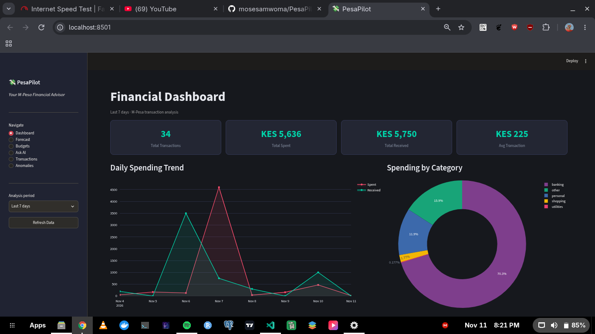
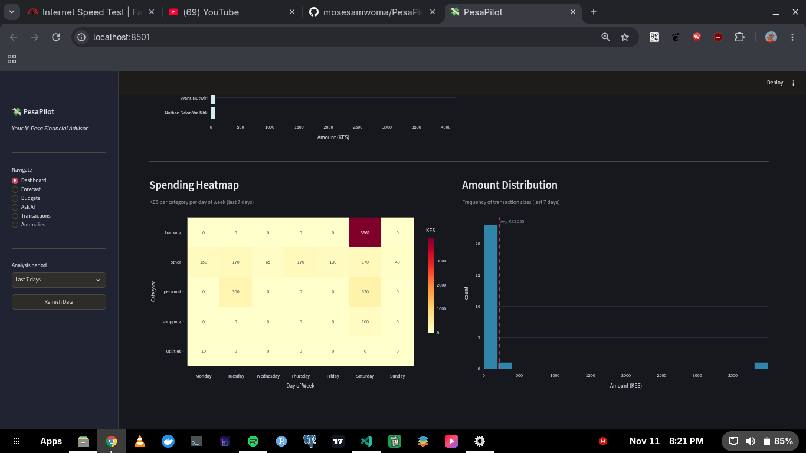
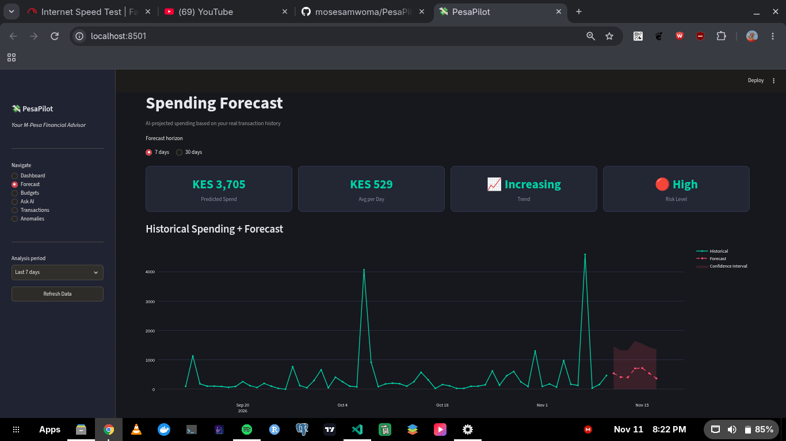
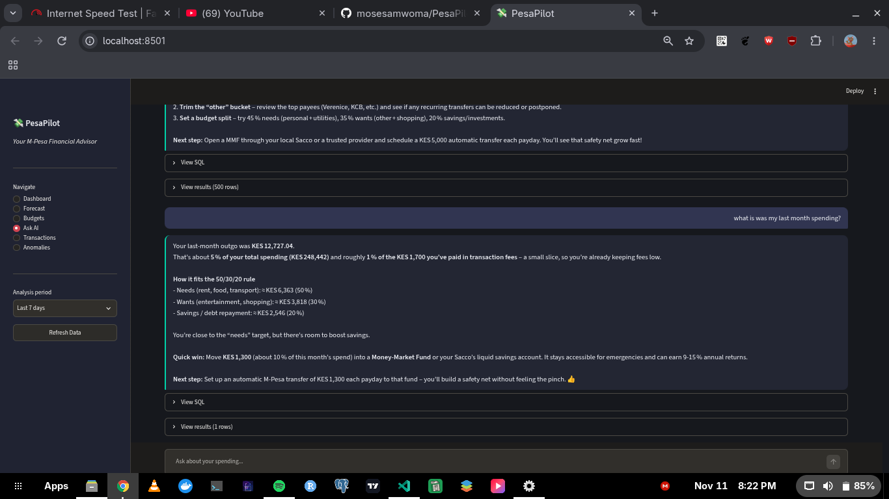

# PesaPilot

AI-powered M-Pesa financial assistant for Kenya. Parses your SMS transaction backup into a self-hosted PostgreSQL database, then lets you explore spending and get Kenyan financial advice via a Streamlit dashboard or WhatsApp.


---

## Features

- **Dashboard** — spending overview, daily trend, category breakdown, top merchants, heatmap, histogram, AI insights

  
  

- **Forecast** — Prophet-powered 7/30-day spending projection with trend, risk level, and a Groq summary
- **Ask AI** — plain-English questions turned into SQL by Groq, answered from your real numbers
- **Budget plans** — a KES needs/wants/savings split sized to your spending
- **Investment guidance** — Sacco / MMF / T-Bill suggestions sized to your free cash flow
- **Transactions** — filterable, searchable history
- **Transaction cost tracking** — M-Pesa fees parsed and stored separately from amount; visible by category and as % of spend
- **Natural-language charts** — describe a chart in plain English; an LLM resolves type, date range, grouping, and metric
- **Smarter anomaly detection** — per-user ML pattern learning, not a fixed z-score
- **Budget goals with alerts** — proactive WhatsApp pings near/over budget
- **WhatsApp Bot** — same questions, charts, advice, and manual SMS logging, from WhatsApp
- **Daily summary** — 9 PM (Africa/Nairobi) end-of-day digest
- **Weekly and monthly summaries** — every Monday 08:00 (previous Monday–Sunday) and on the 1st at 08:30 (previous calendar month), each compared with the period before, with top categories, top recipients and budget standing
- **Two-tier AI** — fast model for chat/insights, smarter model for SQL/analysis/advice
- **Authenticated API** — every route except `/health` requires `API_TOKEN`; loopback-only by default (see [Security](#security))
- **SQL safety guard** — every LLM-generated query is validated `SELECT`/`WITH`-only and runs in a read-only transaction with a 10 s timeout
- **Response caching** — in-memory TTL cache on all Groq calls, cleared on new transactions

> Loading SMS data has no CLI/dashboard button — see [Parse and load your data](#5-parse-and-load-your-data).

---

## WhatsApp Bot — Two Modes

Both share the same FastAPI backend and Postgres database — only the WhatsApp connection differs.

| | `whatsapp_bot.js` | `whatsapp_bot.ts` |
|---|---|---|
| Library | whatsapp-web.js | Baileys |
| Connection | Headless Chrome (Puppeteer) | Pure WebSocket |
| Use case | Local dev | Docker / VPS (production) |
| Memory | ~300–500 MB | ~80–120 MB |
| Auth session | `.wwebjs_auth/` | `.baileys_auth/` |
| npm script | `npm run dev:wwebjs` | `npm run dev` |
| Docker | not used | default |

Use `.js` for local development, `.ts` (Baileys) for anything deployed — it's light enough to run on a Raspberry Pi 3B+.

---

## Prerequisites

- Python 3.12+
- Node.js 20+
- Self-hosted PostgreSQL (local or VPS)
- A [Groq](https://console.groq.com) API key (free tier works)
- Docker + Docker Compose for production
- A spare WhatsApp-capable SIM

---

## 1. Clone and install

```bash
git clone https://github.com/mosesamwoma/PesaPilot.git
cd PesaPilot

python -m venv venv
source venv/bin/activate
pip install -r requirements.txt

npm install
```

---

## 2. Configure environment variables

```bash
scripts/generate_secrets.sh      # creates .env (mode 600) with random POSTGRES_PASSWORD, API_TOKEN, WHATSAPP_PIN
```

Then open `.env` and add your `GROQ_API_KEY` and `WHATSAPP_MAIN_NUMBER`. Never commit `.env` (already in `.gitignore`). The app refuses to start while required values are empty or still placeholders — there are no default passwords or keys anywhere in the code.

### Required

| Variable | Notes |
|---|---|
| `POSTGRES_USER` / `POSTGRES_PASSWORD` / `POSTGRES_DB` | Same names the official Postgres Docker image uses. The password is random (generated for you) |
| `API_TOKEN` | Shared secret for the API (24+ random characters). The bot and anything else calling the API send it as `Authorization: Bearer <token>` |
| `GROQ_API_KEY` | console.groq.com → API Keys |
| `WHATSAPP_MAIN_NUMBER` | e.g. `254712345678` — the number you text the bot **from** |
| `WHATSAPP_PIN` | Random code (generated for you), used for manual SMS entry. Never printed to logs |

`POSTGRES_HOST=auto` (default) lets one `.env` work everywhere — bare metal (`127.0.0.1`), Docker (`host.docker.internal`, falling back to `172.17.0.1`), Podman (`host.containers.internal`). Set it explicitly to skip detection, e.g. for a remote Postgres server. Passwords with special characters are safe as-is — no URL-encoding needed.

### Optional (defaults shown)

| Variable | Default | Purpose |
|---|---|---|
| `API_URL` | `http://127.0.0.1:8000` | Where the bot finds the FastAPI service |
| `WHATSAPP_API_PORT` | `8000` | FastAPI port |
| `WHATSAPP_LID` | empty | WhatsApp's internal ID for your number. Both bots resolve it automatically, so leave it empty. Set it only if the bot ignores your messages: the log prints the sender next to `From:` — copy that number here and restart |
| `LLM_MODEL_FAST` | `openai/gpt-oss-20b` | Chat / dashboard insights |
| `LLM_MODEL_SMART` | `openai/gpt-oss-120b` | SQL generation, analysis, advice |
| `LLM_TEMPERATURE` | `0.6` | Groq sampling temperature |
| `LLM_MAX_TOKENS` | `1536` | Max tokens per response |
| `TZ` | `Africa/Nairobi` | Log timestamps, daily-summary cron |
| `WEEKLY_SUMMARY_CRON` | `0 8 * * 1` | When the weekly summary is sent (5-field cron, Africa/Nairobi). `off` disables it |
| `MONTHLY_SUMMARY_CRON` | `30 8 1 * *` | When the monthly summary is sent (5-field cron, Africa/Nairobi). `off` disables it |
| `WHATSAPP_USE_PAIRING_CODE` | `false` | Pairing code instead of QR (Baileys) |
| `BAILEYS_AUTH_PATH` | `./.baileys_auth` | Baileys session storage |
| `WWEBJS_AUTH_PATH` | `./.wwebjs_auth` | whatsapp-web.js session storage |
| `LLM_REASONING_EFFORT` | `low` | `low` / `medium` / `high` |
| `API_TIMEOUT` | `20` | Seconds before a Groq call is aborted |
| `API_BIND` | `127.0.0.1` | Docker only: host interface the API port is published on. Keep `127.0.0.1`; to reach the API remotely use a TLS reverse proxy, not `0.0.0.0` |
| `API_BIND_HOST` | `127.0.0.1` | Interface the API process binds to outside a container (the compose files set `0.0.0.0` *inside* the container, which only the host-side `API_BIND` exposes) |
| `DASHBOARD_PASSWORD` | empty | Optional login for the Streamlit dashboard. The dashboard itself only listens on `127.0.0.1` (`.streamlit/config.toml`) |
| `POSTGRES_SSLMODE` | empty | Set to `require` / `verify-full` when Postgres is on another machine |
| `CORS_ORIGINS` | empty (CORS off) | Comma-separated full origins allowed to call the API from a browser, e.g. `https://app.example.com,http://[2001:db8::1]:8501`. The bot and dashboard do not need it |
| `API_AUTH_FAIL_LIMIT` | `10` | Wrong-token attempts per IP per 5 minutes before the API answers `429` |
| `API_RATE_LIMIT_PER_MIN` | `120` | Authenticated API requests allowed per minute |
| `API_AI_RATE_LIMIT_PER_MIN` | `30` | Per-minute cap for `/ask`, `/anomalies` and `/budget-check` (protects your Groq quota) |
| `BAILEYS_LOG_LEVEL` | `info` | Baileys/pino log level |
| `WHATSAPP_QR_LINK` | `false` | Keep `false`. `true` prints a link that sends your WhatsApp login QR (a device-linking secret) to the third-party api.qrserver.com. Use `WHATSAPP_USE_PAIRING_CODE=true` if your terminal cannot draw the QR |

---

## 3. Create the database schema

```bash
scripts/setup_db.sh
```

This reads `POSTGRES_USER` / `POSTGRES_PASSWORD` / `POSTGRES_DB` from `.env`, creates (or updates the password of) the role, creates the database and applies `schema/init_db.sql`. It never prints the password and has no default one. Re-run it after rotating the password.

> Postgres never runs inside Docker here — `docker-compose.yml` only runs the app. Always run `psql` from a machine with network access to your Postgres server.

`schema/init_db.sql` is idempotent — re-running it on an existing database is safe and picks up schema fixes. All SQL functions and views compute dates in `Africa/Nairobi` time regardless of the database server's timezone. The old `run_query` function and the unused `daily_summary` / `category_summary` views were removed; drop them from an existing database with `DROP FUNCTION IF EXISTS run_query(TEXT); DROP VIEW IF EXISTS daily_summary, category_summary;`.

Already have a `transactions` table without `transaction_cost`? Run this additive migration instead:

```bash
PGPASSWORD="$POSTGRES_PASSWORD" psql -h 127.0.0.1 -p "$POSTGRES_PORT" -U "$POSTGRES_USER" -d "$POSTGRES_DB" -c "ALTER TABLE transactions ADD COLUMN IF NOT EXISTS transaction_cost DECIMAL(12,2) NOT NULL DEFAULT 0;"
```

Existing rows backfill to `0` — re-import your SMS backup afterward to get real fee amounts.

---

## 4. Get your M-Pesa data

1. Install [SMS Backup & Restore](https://play.google.com/store/apps/details?id=com.riteshsahu.SMSBackupRestore)
2. **Back Up** → **SMS only** → save to storage or Drive
3. Transfer the XML to your computer, place it in `data/raw/`

---

## 5. Parse and load your data

```bash
python -c "from src.analyzer import MpesaAnalyzer; count = MpesaAnalyzer().load_transactions('data/raw/your-sms-backup.xml', 'data/processed/mpesa_transactions.csv'); print(f'Loaded {count} transactions')"
```

Saves a cleaned CSV to `data/processed/` and upserts into Postgres — safe to re-run (upserted by `transaction_id`).

**What gets imported (and what doesn't):**

| Message | Result |
|---|---|
| Inbox SMS from sender `MPESA` starting with a 10-character transaction code and `Confirmed` (or `Congratulations! <code> confirmed`) | Imported — codes made only of letters are valid and are kept. Messages you sent, and messages from banks, Safaricom promos or other senders, are ignored |
| Inbox SMS from sender `MPESA JUMBE` (`<code> Confirmed. You sent: …  Paid to: …`) | Imported as a `payment`. It has no balance or fee, and it usually mirrors a normal M-Pesa SMS with the same code — when both exist the one with the balance wins, whichever arrives first |
| Promos such as `CONGRATULATIONS! Loan limit approved…` or `CONFIRMED. You Qualify to Borrow…` | Ignored — no transaction code, and not from M-Pesa. The same rule applies to manual `PIN-SMS` entries |
| `Give KshX cash to <agent>` | Cash **deposit** → `credit` / `banking` |
| `Withdraw KshX from <agent>` | `withdrawal` / `banking` |
| `You bought KshX of airtime` | `airtime` / `utilities`, recipient `Airtime` |
| Reversals (`Reversal of transaction …` and `Your original transaction … has been reversed … credited`) | `credited to your M-PESA` → `credit`; `debited from` → `debit`; recipient `M-Pesa Reversal` |
| Balance enquiries, cancelled/failed/invalid-PIN/insufficient-funds notices, declined reversals | Skipped — not money movement |
| Fuliza drawdown notices and Fuliza repayments | Skipped — the purchase itself is already recorded, so counting the loan or its repayment would double-count spending |

Timestamps are stored in Nairobi local time (the SMS receipt time, or the time printed in the message when delivery was delayed by more than 10 minutes). `merchant_category` is decided from the recipient/account name only — never from the promotional footer of the SMS — and money sent to or received from a phone number is categorised `personal`.

**Upgrading an existing database:** re-run the import above so previously stored rows are corrected (timestamps, deposits, categories, recipients, and amounts of transactions whose code contains `KES`/`KSH` such as `TBI8KES7AE`, which used to be stored as Ksh 7 instead of Ksh 80), then remove rows from messages that are no longer imported:

```sql
DELETE FROM transactions
WHERE body ILIKE '%Fuliza M-PESA amount is%'
   OR body ILIKE '%used to % pay your outstanding Fuliza%';
```

---

## 6. Run locally

**Dashboard:**
```bash
streamlit run dashboard/app.py
```
Open [http://localhost:8501](http://localhost:8501).

> The API and both bots need `API_TOKEN` in `.env` (the API will not start without it). The dashboard reads the database directly and does not use the API.

**API + WhatsApp bot (whatsapp-web.js, local dev):**
```bash
npm run api          # Terminal 1
npm run dev:wwebjs    # Terminal 2
```
Scan the QR: WhatsApp → Settings → Linked Devices. Session persists in `.wwebjs_auth/`.

**API + WhatsApp bot (Baileys, also works locally):**
```bash
npm run api   # Terminal 1
npm run dev   # Terminal 2
```
Session persists in `.baileys_auth/`.

> The Streamlit dashboard is local-only (bound to `127.0.0.1`) and not included in the Docker image.

---

## npm scripts

```bash
npm run api          # FastAPI on 127.0.0.1:8000
npm run dev           # Baileys bot via ts-node, auto-restart
npm run dev:wwebjs    # whatsapp-web.js bot via nodemon
npm run build         # Compile whatsapp_bot.ts -> dist/
npm start             # Run compiled Baileys bot
npm run start:wwebjs  # Run whatsapp-web.js bot
npm run typecheck     # Type-check the TypeScript bot
npm run clean         # Remove dist/ and auth folders
```

---

## CLI reference

There is no CLI wrapper. Start the API with `npm run api` and the dashboard with `streamlit run dashboard/app.py`. For a database connection check: `python -c "from src.database import PostgresDB; PostgresDB()"`.

---

## The Forecast page

Uses [Meta Prophet](https://facebook.github.io/prophet/) to project spending 7 or 30 days out. Needs at least 14 days of history.



1. Pulls up to 180 days of debit transactions
2. Aggregates into a zero-filled daily series
3. Prophet fits a linear-growth model with weekly seasonality
4. Cached 6 hours, invalidated on new inserts
5. Groq writes a plain-English summary, framed as a prediction

**Trend:** Increasing/Decreasing/Stable, by ±7% change between forecast halves.
**Risk:** High (>25% above pace or volatility >0.9) / Moderate (10–25% or 0.6–0.9) / Low otherwise.

---

## What you can ask the bot



| You send | What happens |
|---|---|
| `pie chart of my spending by category last month` etc. | Chart image, any type + date range, in your own words |
| `how much has M-Pesa charged me in fees this month?` | Fee breakdown, separate from spending |
| `What did I spend on food?` | Plain-English KES + % answer |
| `Give me a budget plan` | Needs/wants/savings split, one category to trim |
| `What should I invest in?` | Sacco / MMF / T-Bill suggestion |
| `forecast` / `forecast 30 days` | Forecast with trend, risk, AI summary |
| `Summary` / `Daily summary` / `Today` | Period or daily digest |
| `Weekly summary` | Last full week (Mon–Sun) vs the week before |
| `Monthly summary` | Last full calendar month vs the month before |
| `help` | Full command list |
| `1234-MJ7XK2P9 Confirmed...` | Manual SMS: `PIN-PASTE_SMS_HERE` |

Anyone texting the number who isn't `WHATSAPP_MAIN_NUMBER`/`WHATSAPP_LID` is left alone — no auto-reply, so you can answer manually.

### Scheduled summaries

The bot sends these to `WHATSAPP_MAIN_NUMBER` on its own, using cron in `Africa/Nairobi` time:

| Job | Default schedule | Covers | Env override |
|---|---|---|---|
| Daily | `0 21 * * *` | Today | not configurable |
| Weekly | `0 8 * * 1` (Monday 08:00) | Previous Monday to Sunday | `WEEKLY_SUMMARY_CRON` |
| Monthly | `30 8 1 * *` (1st, 08:30) | Previous calendar month | `MONTHLY_SUMMARY_CRON` |

Each weekly and monthly report shows totals, net flow, M-Pesa fees, closing balance, the change against the period before, busiest day, biggest expense, top categories, top recipients, and how each weekly or monthly budget ended up. If the bot is offline or the API fails when a job fires, it retries up to 3 times, 10 minutes apart. Set a variable to `off` to disable that job, or to any valid 5-field cron expression to move it. An invalid expression is ignored with a warning and the default is used.

The same reports are available on request with `Weekly summary` and `Monthly summary`, and on demand over the API:

```bash
curl -H "Authorization: Bearer $TOKEN" http://127.0.0.1:8000/weekly-summary
curl -H "Authorization: Bearer $TOKEN" http://127.0.0.1:8000/monthly-summary
```

They return `{"summary": "..."}`, or `503` if the database could not be read.

---

## Docker (VPS / Production)

Uses Baileys (`whatsapp_bot.ts`) only — pure WebSocket, no Chromium, ~80 MB footprint. `whatsapp_bot.js` is for local dev and never runs in the container. One container runs both FastAPI and the bot.

```bash
scripts/prepare_dirs.sh            # once: the container runs as UID 10001, not root
docker compose up -d --build
docker compose logs -f pesapilot
```

The container runs as an unprivileged user with all Linux capabilities dropped and `no-new-privileges`; the app code is read-only to it, and only `sessions/` (mode 700) and `data/` are writable. Compose refuses to start if a required secret is missing.

Health check (run on the VPS — the API is bound to `127.0.0.1` by default): `curl http://127.0.0.1:8000/health`

**Persisted (bind mounts):**

| Host path | Container path | Purpose |
|---|---|---|
| `./sessions` | `/app/.baileys_auth` | Baileys session |
| `./data` | `/app/data` | Transaction files |

```bash
tar czf pesapilot-backup-$(date +%F).tar.gz ./sessions ./data
```

**Management:**
```bash
docker compose ps
docker compose logs -f pesapilot
docker compose restart pesapilot
docker compose down
docker compose up -d --build

# Force a new QR scan
docker compose exec pesapilot rm -rf /app/.baileys_auth
docker compose restart pesapilot
```

**Test the API** (run these on the VPS, or via `ssh -L 8000:127.0.0.1:8000 user@YOUR_VPS_IP` from your laptop):
```bash
curl http://127.0.0.1:8000/health

TOKEN="$(grep '^API_TOKEN=' .env | cut -d= -f2-)"
curl -X POST http://127.0.0.1:8000/ask \
  -H "Authorization: Bearer $TOKEN" \
  -H "Content-Type: application/json" \
  -d '{"question": "What did I spend on food?"}'
```
Without the token every route except `/health` returns `401`.

---

## Redeploying after a code change

`redeploy.sh` syncs local changes to your VPS and rebuilds/restarts the container. No hardcoded server details — you're prompted each run.

```bash
chmod +x redeploy.sh
./redeploy.sh
```

You'll be asked for VPS username, host/IP, and the project path relative to the remote home (default `PesaPilot`), then your SSH password. It rsyncs the project (skipping `node_modules`, `venv`, `dist`, `.git`, sessions, auth, logs), rebuilds via `docker compose up -d --build`, then shows container status.

```bash
./redeploy.sh --no-build   # sync + restart, no rebuild
./redeploy.sh --logs       # tail logs after deploying
```

---

## Security

**What protects you**

- Every API route except `/health` requires `API_TOKEN` (constant-time check). Without it nobody can read financial data, ask the AI questions, change budgets or submit fake SMS transactions. The API refuses to start without a strong token, and `/docs`, `/redoc` and `/openapi.json` are disabled.
- The API is published on `127.0.0.1` only. Keep these in `.env`:
  ```
  API_BIND=127.0.0.1
  API_BIND_HOST=127.0.0.1
  CORS_ORIGINS=
  WHATSAPP_QR_LINK=false
  ```
- Errors returned to clients never contain exception text; the bot never logs your PIN or pasted SMS; the container runs as non-root.
- Abuse limits: wrong-token attempts are throttled per IP (`API_AUTH_FAIL_LIMIT`, then `429`; your valid token is never locked out), authenticated calls are capped per minute (`API_RATE_LIMIT_PER_MIN`), AI/anomaly/budget-check calls have a stricter cap (`API_AI_RATE_LIMIT_PER_MIN`), request bodies over 32 KB are rejected with `413`, and every response carries `nosniff`, `no-store` and a locked-down CSP.
- AI-written SQL is validated (single read-only `SELECT`/`WITH`, no quoted identifiers, no system catalogs, no `pg_*`, `information_schema`, `generate_series`, `INTO`) and then runs in a read-only transaction with a 10 second timeout and a 500-row cap. Names copied from SMS messages are flattened before they reach the AI, and the AI is told to treat them as data, never instructions.
- The Streamlit dashboard locks out for 30 seconds (doubling up to 15 minutes) after 5 wrong passwords, and warns in the sidebar when `DASHBOARD_PASSWORD` is not set.
- The production image no longer ships `whatsapp-web.js` / `puppeteer` (dev-only packages with known advisories): they are dev dependencies and `npm prune --omit=dev` removes them. `npm audit --omit=dev` reports 0 vulnerabilities.
- The bot warns at startup if `API_URL` is neither HTTPS nor localhost, because the API token would otherwise cross the network unencrypted.

**Rotate secrets** (do this now if a `.env`, key, session folder or SMS file was ever shared, committed or pasted anywhere):

1. `scripts/generate_secrets.sh --rotate` → new `POSTGRES_PASSWORD`, `API_TOKEN`, `WHATSAPP_PIN`; then `scripts/setup_db.sh` to apply the DB password.
2. `GROQ_API_KEY`: create a new key at console.groq.com, delete the old one, paste the new one into `.env`.
3. WhatsApp: on your phone open Settings → Linked Devices, log out every device you don't recognise, delete `sessions/` (or `.wwebjs_auth/`) and pair again.
4. Restart: `docker compose up -d --force-recreate`.

Keep `.env`, `sessions/` (`.baileys_auth/`) and your SMS `.xml` exports private — all are git-ignored and excluded from the image and from `redeploy.sh` uploads.

**Before exposing anything publicly:** put the API behind a TLS reverse proxy (the token is then protected in transit). Minimal Caddy example — Caddy gets the certificate automatically:

```
api.example.com {
    reverse_proxy 127.0.0.1:8000
}
```

Callers must still send `Authorization: Bearer <API_TOKEN>`. Add rate limiting at the proxy if the hostname is public. Never set `API_BIND=0.0.0.0` instead. The Streamlit dashboard has no HTTPS of its own: keep it on localhost (reach it over `ssh -L 8501:127.0.0.1:8501`), and set `DASHBOARD_PASSWORD` if anyone else can reach the machine.

---

## How the AI advice is grounded

Every Groq question is paired with live context from Postgres: summary stats, top categories, top merchants, recent daily trend, detected anomalies. A Kenya-specific system prompt (`src/groq_client.py`) enforces amounts + percentages, comparisons to averages, one actionable tip, real Kenyan options (Sacco/MMF/T-Bills), a budget split, an emergency-fund nudge — never Fuliza or a named bank.

| Model | Used for |
|---|---|
| `LLM_MODEL_FAST` | `chat()`, `generate_insights()`, `generate_forecast_insights()` |
| `LLM_MODEL_SMART` | `generate_sql()`, `analyze_results()`, `budget_plan()`, `investment_advice()` |

**SQL safety guard** (`src/sql_guard.py`): every LLM query passes `is_safe_select_sql()` — must start with `SELECT` or `WITH`, no `;`, no comments, none of `DROP/DELETE/UPDATE/INSERT/ALTER/TRUNCATE/GRANT/REVOKE/EXEC/EXECUTE/CREATE/ATTACH/MERGE/CALL/COPY`, no `pg_*`/`lo_*`/`dblink`/`set_config` functions. It then runs in a read-only transaction with a 10 s statement timeout, capped at 500 rows. User *questions* are only rejected when they contain actual destructive statements (e.g. `drop table …`), so ordinary questions like "how much did I spend on call credit?" work.

**Caching:** every Groq call is cached in-memory by a hash of (system, user) prompt, TTL from 5 min (chat) to 1 hour (SQL), cleared on new transactions.

---

## Troubleshooting

| Issue | Fix |
|---|---|
| `.env file not found!` | Copy `.env.example` to `.env` first |
| `relation ... does not exist` / missing function errors | Apply `schema/init_db.sql` |
| `ModuleNotFoundError: No module named 'src'` | Run from the project root |
| No transactions after loading XML | Confirm it's an SMS Backup & Restore export with M-Pesa messages |
| Port 8000 in use | Change `WHATSAPP_API_PORT`, update `API_URL` and `docker-compose.yml` |
| API exits with `API_TOKEN must be set…` | Run `scripts/generate_secrets.sh` (or set a 24+ character `API_TOKEN` in `.env`) |
| Bot says `API server rejected the token` | `API_TOKEN` differs between the bot and the API — they must read the same `.env` |
| `401 Unauthorized` from curl | Send `-H "Authorization: Bearer $API_TOKEN"` (or `X-API-Key`) |
| `429 Too many requests` | A rate limit tripped; wait for the `Retry-After` seconds or raise `API_RATE_LIMIT_PER_MIN` / `API_AI_RATE_LIMIT_PER_MIN` in `.env` |
| `413 Request body too large` | Request bodies are capped at 32 KB; send one SMS or question at a time |
| Container: `is not writable by the container user` | Run `scripts/prepare_dirs.sh` (folders must be owned by UID/GID 10001) |
| Compose: `Set POSTGRES_PASSWORD in .env` | A required variable is empty — see [Configure](#2-configure-environment-variables) |
| Baileys `405` loop, no QR | Wipe `.baileys_auth/` and restart |
| Baileys QR never appears | Check container internet: `docker compose exec pesapilot curl -I https://web.whatsapp.com` |
| wwebjs `Failed to launch browser` | Chrome missing or wrong `PUPPETEER_EXECUTABLE_PATH` (local dev only) |
| wwebjs `profile already in use` | Delete `.wwebjs_auth/`, restart, rescan |
| Podman permission denied on volumes | Confirm `:Z` suffix in `podman/compose.yml` |
| Session keeps logging out | Confirm auth path isn't wiped by your deploy process |
| Charts not sending | `pip install matplotlib seaborn` |
| Forecast "not enough data" | Needs 14+ distinct days of debits |
| Forecast "engine unavailable" | `pip install prophet cmdstanpy` |
| Groq rate limit / empty responses | Wait ~60s; lower `LLM_MAX_TOKENS` |
| `streamlit: command not found` | `source venv/bin/activate` |
| Dates look 3 hours off after upgrading | Re-run the import (step 5) — old rows were stored in UTC |
| `balance` empty for some rows | Not every SMS includes it; the parser now imports only M-Pesa transaction messages, which all do |
| Bot ignores your messages | The `From:` line in the bot log shows the ID WhatsApp used. If it is not your phone number, copy it into `WHATSAPP_LID` and restart |
| Can't connect to Postgres | Check detected host in startup logs; avoid `localhost` (use `127.0.0.1` or real IP) |
| `time data ... doesn't match format` | Ensure timestamp parsing uses `format='ISO8601'` everywhere |

---

## Future Improvements

- Multi-user support (currently one number/database)
- Other providers — Airtel Money, T-Kash
- Self-hosted/local LLM option
- CI/CD via GitHub Actions
- Native mobile app